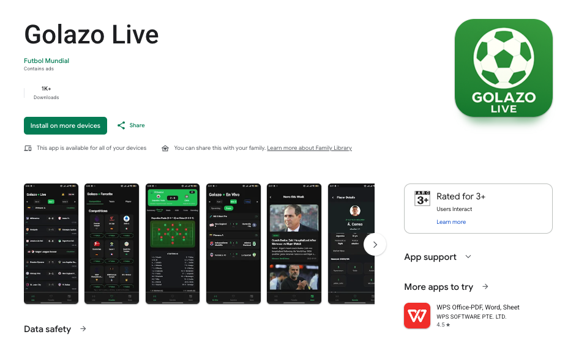
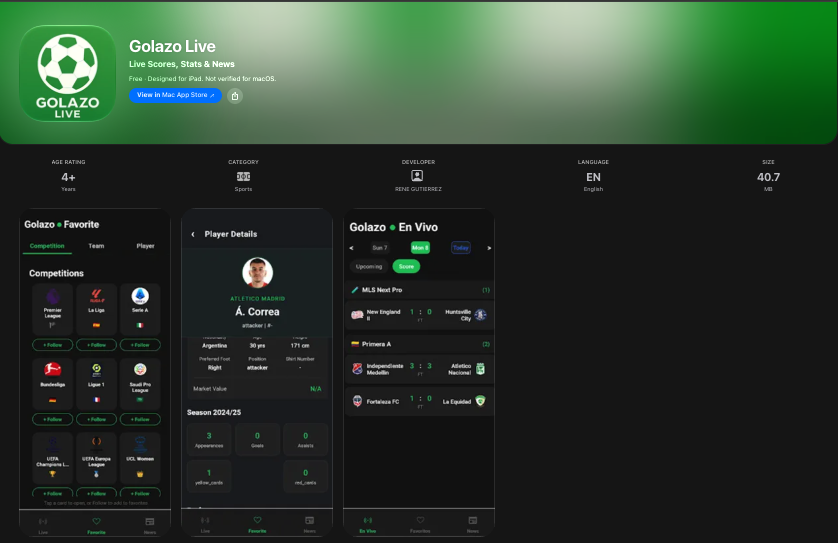

<div align="center">

<!-- Hero Banner & Header Logo -->
<a href="https://github.com/mohammad-al-asad/Golazo-Live">
  
</a>

<br />
<br />

<a id="overview"></a>

# Golazo Live: Live Scores, Stats & News — Global Football Platform

**A real-time, cross-platform football intelligence mobile application delivering live scores, match centers with tactical pitch lineups, detailed head-to-head statistics, and global football news powered by API-Football and AdMob.**

<br />

<a id="tech-stack"></a>

<!-- Tech Stack Badges (for-the-badge style) -->

[](https://reactnative.dev/)
[](https://expo.dev/)
[](https://reactnavigation.org/)
[](https://www.i18next.com/)
[](https://admob.google.com/)
[](https://expo.dev/eas)
[](https://www.api-football.com/)
[](#license)

<br />

<a id="cta-links"></a>

<!-- Live Demo & CTA Links -->
<p align="center">
  <a href="https://apps.apple.com/us/app/golazo-live/id6753016723"><b>App Store (iOS)</b></a> &nbsp;•&nbsp;
  <a href="https://play.google.com/store/apps/details?id=com.golazo.live"><b>Google Play (Android)</b></a> &nbsp;•&nbsp;
  <a href="#architecture"><b>Architecture</b></a> &nbsp;•&nbsp;
  <a href="#core-features"><b>Core Features</b></a> &nbsp;•&nbsp;
  <a href="https://github.com/mohammad-al-asad/Golazo-Live/issues"><b>Report Bug</b></a>
</p>

<br />

<!-- Hero Banner Graphic -->


</div>

---

## 📑 Table of Contents

- [ Title & Value Proposition](#overview)
- [ Tech Stack Badges](#tech-stack)
- [ Store Links & Production Status](#cta-links)
- [ Interface Preview & Production Metrics](#interface-preview)
- [ Core Features & Platform Modules](#core-features)
  - [ Live Scores & Real-Time Match Tracker](#live-scores)
  - [ Interactive Match Center & Pitch Lineups](#match-center)
  - [ Global League Coverage & Table Standings](#league-coverage)
  - [ Club Portals & Player Performance Deep-Dive](#club-player-portals)
  - [ Curated Football News & Daily Push Alerts](#news-alerts)
  - [ Over-The-Air (OTA) Updates & AdMob Monetization](#ota-admob)
- [ Engineering Highlights & Architecture](#architecture)
  - [ System Architecture Overview](#system-architecture)
  - [ Competition & Coverage Matrix](#coverage-matrix)
- [ Project Directory Structure](#project-structure)
- [ Local Development & Setup](#local-setup)
- [ Developer Info & Socials](#developer-info)
- [ License & Proprietary Notice](#license)

---

<a id="interface-preview"></a>

## 🖼️ Interface Preview & Production Metrics

Golazo Live is published worldwide on the **Apple App Store** and **Google Play Store**, serving over **1,000+ football fans** with live match tracking and breaking coverage.

|                                **Apple App Store (iOS)**                                |                                **Google Play Store (Android)**                                 |
| :-------------------------------------------------------------------------------------: | :--------------------------------------------------------------------------------------------: |
|       |            |
|            _Tactical pitch formations, live match minute & league fixtures_             |                _Sub-second score updates across 25+ global competitions_                       |

|                                 **Official Brand Identity**                             |                                **Multi-Lingual Parity (EN / ES)**                             |
| :-------------------------------------------------------------------------------------: | :--------------------------------------------------------------------------------------------: |
|            |                 |
|                  _High-contrast sports UI optimized for mobile viewing_                 |                 _Full Spanish and English translation powered by i18next_                      |

---

<a id="core-features"></a>

## ✨ Core Features & Platform Modules

Golazo Live delivers sub-second sports intelligence and tactical pitch visualization across domestic leagues, international cups, and continental tournaments.

<a id="live-scores"></a>

### **Live Scores & Real-Time Match Tracker**

- **Live Now Feed**: Real-time ticker showcasing ongoing matches worldwide with live scorelines, elapsed match minutes, and extra-time indicators.
- **30-Second Auto Refresh**: Automated background polling during live games delivering immediate updates without manual reloads.
- **Day-by-Day Fixture Browser**: Calendar date picker enabling users to browse past results, today's schedule, and upcoming fixtures grouped by league.

<a id="match-center"></a>

### **Interactive Match Center & Pitch Lineups**

- **Interactive Pitch Visualization (`PitchField.js`)**: Dynamic 2D pitch view plotting starting elevens in tactical formations (e.g., 4-3-3, 3-5-2) with player jersey numbers, substitutions, and manager info.
- **Granular Match Statistics**: Possession percentages, shots on target, expected goals (xG), fouls, offsides, yellow/red cards, and corner counts.
- **Head-to-Head (H2H) & Form Analysis**: Historical matchup results and recent 5-game form guides for both contending sides.
- **Minute-by-Minute Match Commentary**: Chronological timeline of goals, VAR decisions, card infractions, and tactical substitutions.

<a id="league-coverage"></a>

### **Global League Coverage & Table Standings**

- **25+ Global Competitions**: Premier League, UEFA Champions League, La Liga, Serie A, Bundesliga, Ligue 1, Saudi Pro League, MLS, Liga MX, Copa Libertadores, domestic cups, and women's football (UCL Women).
- **Comprehensive League Tables**: Live standings with games played, goal differences, points, qualification zones (UCL/UEL), and relegation drop zones.
- **Golden Boot & Assist Leaders**: Top goalscorers and playmaker assist leaderboards updated after every matchday.

<a id="club-player-portals"></a>

### **Club Portals & Player Performance Deep-Dive**

- **Club Overview**: Roster lists, upcoming schedule, transfer logs, historical trophies, and form trajectories.
- **Player Profiles**: Individual player cards featuring biographical info, primary positions, season appearances, goals, assists, and disciplinary statistics.
- **Favorites Hub**: One-tap bookmarking for favorite clubs, competitions, and players for instant shortcut access.

<a id="news-alerts"></a>

### **Curated Football News & Daily Push Alerts**

- **News This Week Carousel**: High-impact editorial news feed powered by **NewsAPI.ai** covering breaking transfers and match reports.
- **Push Notifications (`expo-notifications`)**: Instant alerts for breaking international football news and kickoff notifications.
- **In-App Notification Center**: Notification inbox storing past alerts for review anytime.

<a id="ota-admob"></a>

### **Over-The-Air (OTA) Updates & AdMob Monetization**

- **Instant EAS Update Integration**: JavaScript bug fixes, styling polishes, and configuration changes deployed directly to devices over-the-air without app store approval wait times.
- **Google Mobile Ads (AdMob)**: Integrated non-intrusive banner ad placements across Live, News, and Favorites views.

---

<a id="architecture"></a>

## 🏗️ Engineering Highlights & Architecture

<a id="system-architecture"></a>

### System Architecture Overview

Golazo Live coordinates high-speed sports REST APIs, asynchronous response caching with per-resource expiration, and over-the-air binary synchronization.

```
+-----------------------------------------------------------------------------------+
|                        Client Layer (React Native / Expo SDK 55)                  |
|   React Navigation │ PitchField Visualizer │ i18next (EN/ES) │ AdMob Banners      |
+-----------------------------------------------------------------------------------+
                         │                                    │
          ┌──────────────┴──────────────┐      ┌──────────────┴──────────────┐
          ▼ (Sports Data API)           ▼ (News Data API)     ▼ (OTA Deployment)
+-------------------+         +-------------------+         +-------------------+
|    API-Football   |         |    NewsAPI.ai     |         |    EAS Update     |
| Live Scores, Form,|         | Football Articles,|         | Over-The-Air JS   |
| Lineups & Tables  |         | Breaking Headlines|         | Code Hydration    |
+-------------------+         +-------------------+         +-------------------+
                         │                                    │
                         ▼                                    ▼
+-----------------------------------------------------------------------------------+
|                           Smart Local Cache & Persistence                         |
|   AsyncStorage │ Per-Resource Expiry (Scores 30s, Standings 1h, Logos 24h)        |
+-----------------------------------------------------------------------------------+
```

<a id="coverage-matrix"></a>

### Competition & Coverage Matrix

| Competition Category       | Live Scores | Tactical Pitch Lineups | Head-to-Head & Form | Standings & Stats | News Coverage |
| :------------------------- | :---------: | :--------------------: | :-----------------: | :---------------: | :-----------: |
| **Top 5 European Leagues** | Full Access |      Full Access       |     Full Access     |    Full Access    |  Full Access  |
| **UEFA Champions League**  | Full Access |      Full Access       |     Full Access     |    Full Access    |  Full Access  |
| **Americas (MLS, Liga MX)**| Full Access |      Full Access       |     Full Access     |    Full Access    |  Full Access  |
| **Saudi Pro League**       | Full Access |      Full Access       |     Full Access     |    Full Access    |  Full Access  |
| **Domestic & FA Cups**     | Full Access |      Full Access       |     Full Access     |    Full Access    |  Full Access  |
| **Women's Champions League**| Full Access |      Full Access       |     Full Access     |    Full Access    |  Full Access  |

---

<a id="project-structure"></a>

## 📂 Project Directory Structure

```plaintext
Golazo-Live/
├── App.js                              # Application entry point: OTA update checks, notifications & AdMob
├── Components/                         # Modular UI and match presentation components
│   ├── Competition.js                  # Competition header and league tabs
│   ├── CompetitionFixtures.js          # Fixtures and upcoming match list
│   ├── CompetitionResults.js           # Full-time match results list
│   ├── CompetitionStandings.js         # Interactive league table standings
│   ├── CompetitionStats.js             # Top scorers and assist leaders
│   ├── FormMatchDetails.js             # Team recent 5-game form breakdown
│   ├── H2HMatchDetails.js              # Historical head-to-head match cards
│   ├── LineUpMatchDetails.js           # Lineup coordinator & substitute listings
│   ├── PitchField.js                   # 2D football pitch lineup visualizer
│   ├── LiveNow.js                      # Active matches ticker with live minute
│   ├── NewsThisWeek.js                 # Horizontal news article carousel
│   ├── RemoteLogo.js                   # Optimized team crest and league logo loader
│   ├── ScoreOptimized.js               # Performance-optimized live score card
│   ├── SummaryMatchDetails.js          # Match events timeline (goals, cards, VAR)
│   └── TeamOverview.js                 # Team details header and squad list
├── Config/                             # Configuration files
│   └── LeagueConfig.js                 # League IDs, season definitions & news tags
├── Navigation/                         # React Navigation structure
│   ├── BottomTabNavigator.js           # Bottom tab bar (Live, Matches, News, Favorites)
│   └── StackNavigator.js               # Screen stack routes and modal transitions
├── Screens/                            # Main application screen views
│   ├── LiveScreen.js                   # Real-time scores and live match ticker
│   ├── HomeScreen.js                   # Day-by-day fixture browser & date picker
│   ├── MatchDetailsScreen.js           # Comprehensive match center (Tabs: Summary, Lineup, Stats, H2H)
│   ├── CompetitionScreen.js            # League overview, fixtures, standings & stats
│   ├── TeamDetailsScreen.js            # Team squad, upcoming fixtures & league position
│   ├── FavoriteScreen.js               # User bookmarked clubs, players & leagues
│   ├── AllNewsScreen.js                # Full football news feed & search
│   ├── NewsDetailScreen.js             # Full-page article reading view
│   ├── NotificationsScreen.js          # Past push notification inbox
│   └── Onboarding.js                   # Initial team & league preference onboarding
├── Utils/                              # Core utilities & API services
│   ├── ApiFootball.js                  # API-Football v3 REST client
│   ├── NewsApi.js                      # NewsAPI.ai client and article parser
│   ├── CacheManager.js                 # Smart per-resource response caching
│   └── FavoritesManager.js             # Local storage persistence for favorites
├── locales/                            # Internationalization dictionaries
│   ├── en.json                         # English translation strings
│   └── es.json                         # Spanish translation strings
├── assets/ · Images/                   # App icon, splash screen & onboarding artwork
├── showcase/                           # Store listings and production showcase images
├── app.json                            # Expo application configuration manifest
├── eas.json                            # EAS Build and EAS Update configuration profiles
├── package.json                        # Project dependencies and npm scripts
└── README.md                           # Comprehensive documentation
```

---

<a id="local-setup"></a>

## 💻 Local Development & Setup

### Prerequisites

- **Node.js**: v20 LTS or later
- **API-Football API Key**: Obtainable from [api-football.com](https://www.api-football.com/)
- **NewsAPI.ai API Key**: Obtainable from [newsapi.ai](https://newsapi.ai/)
- **Android Studio & SDK** (JDK 17) or **Xcode** (macOS only)

### Installation & Run

1. **Clone the repository:**
   ```bash
   git clone https://github.com/mohammad-al-asad/Golazo-Live.git
   cd Golazo-Live
   ```

2. **Install dependencies:**
   ```bash
   npm install
   ```

3. **Configure Environment Variables:**
   Create a `.env` file in the root directory:
   ```env
   EXPO_PUBLIC_FOOTBALL_API_KEY=your_api_football_key
   EXPO_PUBLIC_NEWS_API_KEY=your_newsapi_ai_key
   ```

4. **Launch Application:**
   ```bash
   npx expo run:android         # Launch on Android device / emulator
   npx expo run:ios             # Launch on iOS simulator (macOS only)
   ```

---

<a id="developer-info"></a>

## 👨‍💻 Developer Info & Socials

Golazo Live is architected, developed, and maintained by experienced mobile engineers and sports technology specialists.

- **Mohammad Al Asad** — _Lead Mobile & Full-Stack Software Engineer_
  - 🌐 GitHub: [@mohammad-al-asad](https://github.com/mohammad-al-asad)
  - 📧 Email: [maasad11914@gmail.com](mailto:maasad11914@gmail.com)

- **Futbol Mundial** — _Product Owner & Publisher_

---

<a id="license"></a>

## 📄 License & Proprietary Notice

Copyright © 2026 Futbol Mundial. All rights reserved.

This software, including its user interface design, pitch rendering algorithms, and data integration architecture, is private and proprietary. Unauthorized distribution, copying, decompilation, or commercial exploitation without prior written consent from Futbol Mundial is strictly prohibited.

<div align="center">
  <b>Built with ❤️ for passionate football fans across the globe</b>
</div>
