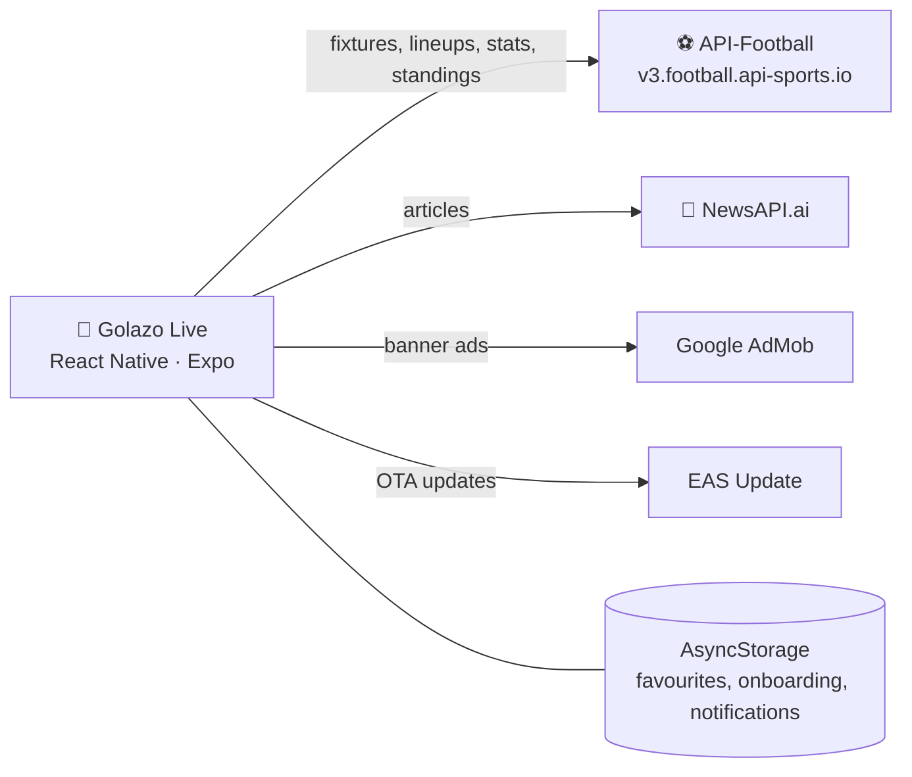

<div align="center">


# Golazo Live: Live Scores, Stats & News

**Live football scores, match stats, lineups, and news from leagues around the world: built, shipped, and run in production.**

A cross-platform **React Native** app built with **Expo**, powered by API-Football and NewsAPI.ai, monetised with **Google AdMob**, and kept up to date with **over-the-air updates**.

[](https://play.google.com/store/apps/details?id=com.golazo.live)
[](https://apps.apple.com/us/app/golazo-live/id6753016723)


</div>

---

## 📸 Showcase

Golazo Live is live on the **App Store** and **Google Play**, with **1,000+ downloads** on Google Play.

| App Store | Google Play |
| :---: | :---: |
|  |  |

---

## ✨ Features

### Live & scores
- **Live now:** every match in progress, with scores and the match minute.
- **Day-by-day scores:** browse past, today's, and upcoming fixtures with a date picker, grouped by competition.
- **Match centre:** **Summary**, **Line Up** (players drawn on a pitch), **Stats**, **H2H**, **Form**, and **Standings** for every match, refreshed automatically every 30 seconds while it's live.

### Competitions, teams & players
- **25 competitions:** Premier League, La Liga, Serie A, Bundesliga, Ligue 1, Saudi Pro League, Champions League, Europa League, UCL Women, MLS, Liga MX, Brazil, Argentina, Colombia, domestic cups, and more.
- **Competition pages:** fixtures, results, standings, and top scorers & assists.
- **Team pages:** overview, recent form, matches, squad, and league table.
- **Player details:** profile, position, and season stats (appearances, goals, assists, cards).

### Favourites, news & notifications
- **Favourites:** follow competitions, teams, and players to keep them one tap away.
- **Football news:** a "News this Week" carousel plus a full news feed with article pages, powered by NewsAPI.ai.
- **Push notifications:** daily football news alerts that open straight to the article, plus an in-app notification inbox.

### Built for real users
- **Over-the-air updates** with `expo-updates`: fixes ship without waiting for store review.
- **Fast and light on data:** cached API responses with per-resource expiry times (scores, standings, teams, players, logos) and pre-loaded logos.
- **Localisation-ready:** English and Spanish translations with i18next.
- **Ad-supported:** Google AdMob banners on the Live, Favourites, and News screens.

---

## 🏗️ Architecture



| Area | Stack |
| --- | --- |
| **App** | Expo SDK 55, React Native 0.83, React 19, JavaScript |
| **Navigation** | React Navigation (bottom tabs + stack) |
| **Data** | Axios, API-Football v3, NewsAPI.ai, cached responses with per-resource expiry |
| **Storage** | AsyncStorage for favourites, onboarding state, and notification history |
| **Localisation** | i18next + react-i18next (English, Spanish) |
| **Engagement** | Expo Notifications |
| **Monetisation** | `react-native-google-mobile-ads` (AdMob banners) |
| **Release** | EAS Build, EAS Submit, EAS Update (OTA) |

---

## 📂 Repository structure

```text
Golazo-Live/
├── App.js                 # App entry: onboarding, OTA update check, AdMob, notifications
├── Screens/               # Live, Home, Favourites, Competition, Team, Match details, News, Notifications, Onboarding
├── Components/            # Score cards, match-centre tabs, pitch line-up, standings, team and player views
├── Navigation/            # Bottom tab + stack navigators
├── Utils/                 # API-Football and news clients, caching, favourites, notifications, date helpers
├── Config/                # League list and news settings
├── locales/               # en / es translations
├── assets/ · Images/      # App icon, splash, onboarding art
├── app.json               # Expo config (bundle IDs, AdMob, updates)
└── eas.json               # EAS build profiles: development, preview, production
```

---

## 💻 Running locally

### Prerequisites
- **Node.js** 20+ and npm
- An **API-Football** key ([api-football.com](https://www.api-football.com/)) and a **NewsAPI.ai** key
- For native builds: **Xcode** (macOS) and/or **Android Studio** with JDK 17

### Setup

```bash
npm install
```

Create `.env` in the project root:

```env
EXPO_PUBLIC_FOOTBALL_API_KEY=your_api_football_key
EXPO_PUBLIC_NEWS_API_KEY=your_newsapi_ai_key
```

Then run a development build (the app uses Google Mobile Ads, a native module, so Expo Go is not supported):

```bash
npx expo run:android
npx expo run:ios       # macOS only
```

---

## 🚀 Releases

Store builds are produced with **EAS Build** using the `production` profile (auto-incremented build numbers, Android App Bundle) and submitted with **EAS Submit**:

```bash
npm run eas:build:android
npm run eas:submit:android
```

JavaScript-only fixes are shipped instantly through **EAS Update**. On launch, the app checks for a new update, downloads it, and reloads, so users stay on the latest version without a store release.

---

<div align="center">

Built by **[Mohammad Al Asad](https://github.com/mohammad-al-asad)** for **Futbol Mundial**

</div>
